#  Zwyka: Habits Tracking Application

Zwyka -- open source code platform-agnostic habits tracker application. The goal of the 
solution is to create a habits tracking application that is intuitive, efficient, and 
inclusive. That empowers users to effortlessly manage their habits while ensuring that no 
one is left behind.

| Type                     | Alpha Version         | Pre-Release                   | Release                       |
| ------------------------ | ----------------------| ----------------------------- | ----------------------------- |
|  Android (Google Play)    | [zwyka_Android.aab](https://github.com/lyskouski/app-tracker/releases/latest) | [Google Play](https://play.google.com/store/apps/details?id=com.tercad.zwyka) | Pending  |
|  Linux                    | [zwyka_Linux.tar.gz](https://github.com/lyskouski/app-tracker/releases/latest) | Not available | Not available |
|  Linux (Snap Store)       | [zwyka_LinuxSnap.snap](https://github.com/lyskouski/app-tracker/releases/latest) |  |  |
|  Linux (Flathub)          | [zwyka_LinuxFlatpak.flatpak](https://github.com/lyskouski/app-tracker/releases/latest) | Not available | Blocked [#73](https://github.com/lyskouski/app-tracker/issues/73) [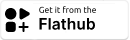](https://flathub.org/apps/com.tercad.zwyka) |
|  Linux (AppImage)         | [Zwyka-x86_64.AppImage](https://github.com/lyskouski/app-tracker/releases/latest) | [Pling Store](https://www.pling.com/p/2380239/) |  |
|  Windows (Microsoft Store) | [zwyka_Windows.msix](https://github.com/lyskouski/app-tracker/releases/latest) | Not available |    |
|  Web                      | [zwyka_Web.tar.gz](https://github.com/lyskouski/app-tracker/releases/latest) | [GitHub Pages: Zwyka](https://lyskouski.github.io/app-tracker/) | [terCAD: Zwyka](https://tercad.com/app/tracker/index.html) |

## Functionality

**Habits**
- Create, edit and delete habits with a title, remarks, an icon (2,000+ Material icons), 
  and a color (palette or custom RGB / HEX).
- Set the active days of the week for each habit; inactive days are marked with "—" in 
  the calendar.
- Set a numeric target with a value and a type (e.g. 10000 steps): the day's state keeps the
  reached value instead of a status mark, and its completion is the value divided by the target.
  Once set, the target can be changed but not turned off.

**Home screen**
- Three views, switched by the tabs on top: `Today`, `Weekly`, and `Overall` (by default); 
  the chosen view is remembered.

**Today**
- Today's habits as a list (archived ones and the ones created later are left out): not done 
  habits first, then the done and skipped ones below the "Completed / Skipped" divider.
- Swipe right to mark a habit as done; a habit with a numeric target asks for the reached value 
  first (prefilled with the target). Swipe left to skip it ("—").
- Tap a habit to set its day state, long press to edit the habit.
- Habits with a numeric target show the reached value and the target 
  (e.g. `5000 / 10000 steps`), others show their mark.

**Weekly**
- A card per habit (archived ones are hidden) with its title, remarks, active days (or "Every  
  day"), and the marks of the current week (from the selected start of the week); today is 
  highlighted.
- Tap a day to set its state, long press on a day to delete its state, long press on the card to 
  edit the habit.

**Overall (Habits Calendar)**
- Table of habits (columns) by days (rows): the last 66 days plus the upcoming 5, scrollable
  in both directions (by touch, or Shift + Scroll Wheel for horizontal scroll and Scroll Wheel
  for vertical, or by keyboard: arrows, Page Up / Page Down, Home / End) with pinned habit headers and dates.
- Mark a day's progress for each habit: `·` started, `\` 25%, `|` 50%, `/` 75%, `X` 100%, 
  `▣` over 100%. Also can be marked as skipped. Long press on a cell ("Day State") will delete its state.
- Habits with a numeric target show the reached value above its type in the cell.
- Long press on a habit header opens the habit details.
- Today's row is highlighted, and a separator marks the start of each week.
- Tap a date to mark the day as skipped ("—") for all habits that are not marked yet.
- Archived (deactivated) habits are grayed out, always shown last, and hide their marks.
- **Day Streak**: the number of consecutive marked days is shown right after each streak ("—" 
  days don't break it).
- **Today's progress**: the top-left corner shows the overall completion of today's habits 
  as a progress bar around the cell, with the percentage in the middle.

**Metrics**
- Open by tapping today's progress: a graph of daily completion (%) over the last 66 days.
- **Habit details** (long press on a habit header): title, remarks, target, completion of every
  day over the last year (days of the week by weeks, like GitHub contributions, colored by the
  completion), max and current Day Streak calculated over the whole history.
- **Goals** (on the habit details): the `(+)` button in the bottom bar adds a goal with a title, 
  a description, and a group (typed, or chosen from the existing groups of the habit). Goals and 
  groups belong to their habit only.
  - Goals of a group are shown in one card; tap a goal to mark it as finished (or not finished 
  again).
  - Long press on a goal to edit its title, description, or group; a group left without goals is 
  removed.
  - Long press on a group card (outside its goals) to delete the group with all its goals, after 
  a confirmation.
  - A group whose goals are all finished is struck through and goes after the active groups.
  - The `↑` button on the top-right corner of a card moves the group up by one position.

**Schedule (Calendar)**
- Day view with hours, like Google or Outlook Calendar: move between days with `<` / `>` 
  or jump back to `Today`.
- Tap a time slot to schedule a habit for 30 minutes, 1 hour, 2 hours, or a custom start 
  and end time, repeated on the selected days of the week, with an optional note.
- Overlapping time ranges are shown side by side; tap a range to edit or delete it.
- Archived (deactivated) habits and their time ranges are hidden.
- Notifications across all platforms (`Desktop`` and `Web`` can't notify while closed, 
  `iOS` allows max 9 daily reminders per day)
- Add to external calendar (Apple, Google, Microsoft)
- The `(+)` button in the bottom bar schedules a habit (today: from the next full hour, other 
  days: from 09:00).

**Timer** (the `Timer` button on the Schedule)
- Watch-like dial of the next 12 hours: scheduled events are arcs in the habit colors 
  (overlapping ones on inner rings), the hand shows the current time.
- The current habit is shown on top, the countdown (hours:minutes) of the current event or until 
  the next one in the middle, and the next events (today and tomorrow) below; in landscape the 
  dial is on the left and the events are on the right.
- The screen stays on while the timer is open; mobile devices vibrate when an event starts, and 
  the completion
  of the habit is asked when its time range ends (intents are skipped).
- Pomodoro: the `(+)` button starts a custom timer for 15 min, 30 min, 1 hour, 2 hours, or a 
  custom number of minutes, optionally for a habit; it vibrates at the end and asks for the 
  completion of the selected habit.

**Settings**
- Language: system default, en_US, de_DE, be_BY, pl_PL, pt_BR, fr_FR, uk_UA, zh_CN, zh_TW, 
  hi_IN, uz_UZ, fa_IR, ar_SA, az_AZ, ja_JP, es_ES, it_IT, tr_TR, ko_KR, nl_NL, cs_CZ, ro_RO, 
  ka_GE, ru_RU, id_ID
- Theme: system default, light, dark
- Start of the week
- Dates format
- Habits order (by creation date, last update, or title; ascending or descending)
- Import / Export data
- Habits' day state representation: symbols, colored circles

**Accessibility** ([WCAG 2.1](https://www.w3.org/TR/WCAG21/))
- Screen readers: every screen announces its title, page titles and sections are headings, and 
  every action is named — including long presses ("Edit habit", "Delete", "Edit goal") and the 
  swipes of the `Today` view ("Done", "Skip"). Status marks are read by their meaning ("100%", 
  "Skip") instead of the symbols, and day cells announce the habit, weekday, date, status, and 
  "Today".
- Toggles, tabs, status buttons, and goals announce whether they are selected or finished; 
  drop-down fields announce their label and the chosen value.
- Errors and loading states are announced without moving the focus.
- Keyboard: everything is reachable by `Tab`, with a visible focus; `Menu` or `Shift` + `F10` 
  replaces a long press; the `Overall` table scrolls by arrows, `Page Up` / `Page Down`, and 
  `Home` / `End`.
- Contrast: texts and controls are readable in both themes; habit colors used as text or icons 
  are adjusted when they are too light or too dark for the background.
- Text grows with the system font size; tabs, toggles, and the bottom bar grow with it.
- The habit completion graph has a text alternative.

## Screenshots

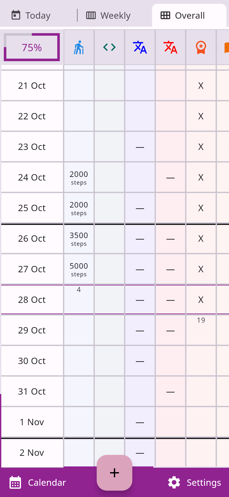 . 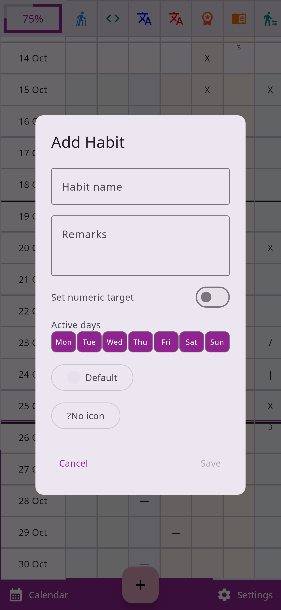 . 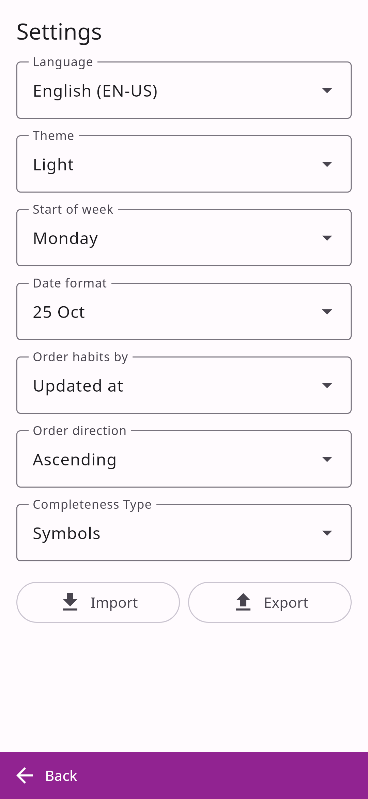

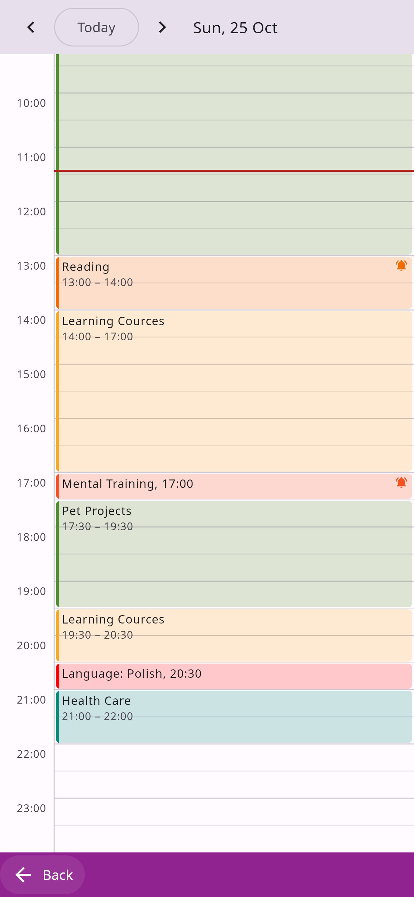 . 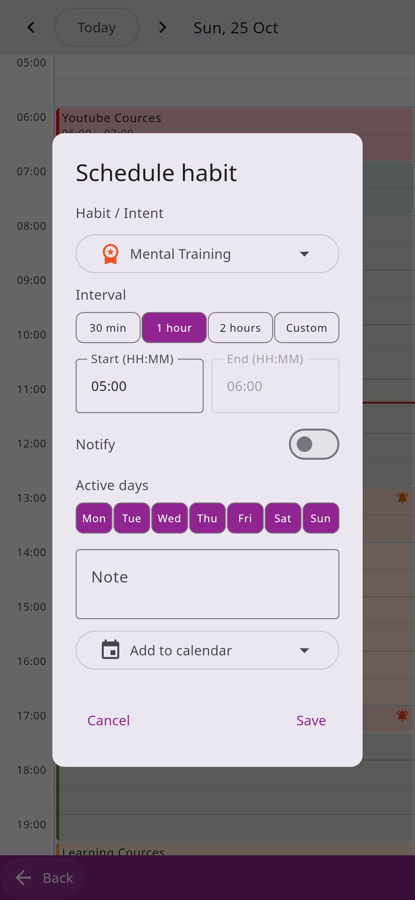 . 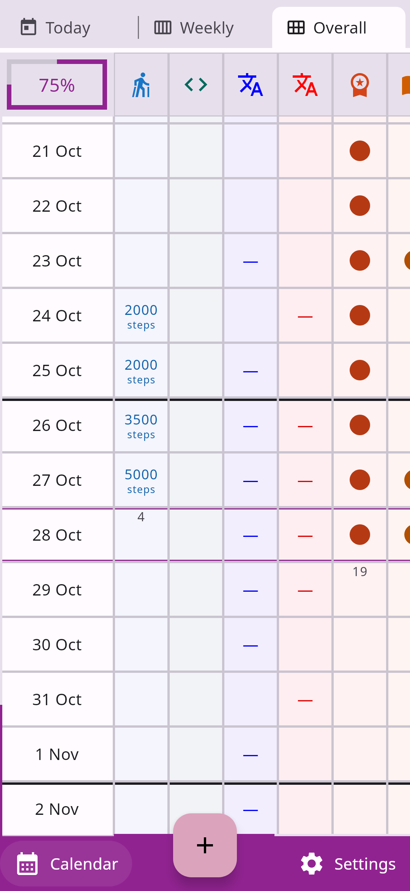

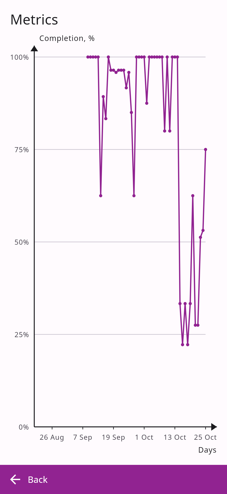 . 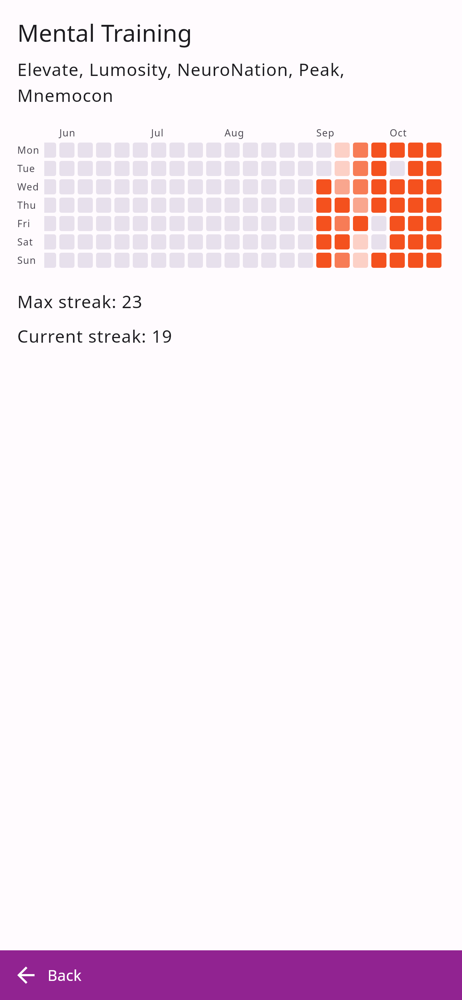 . 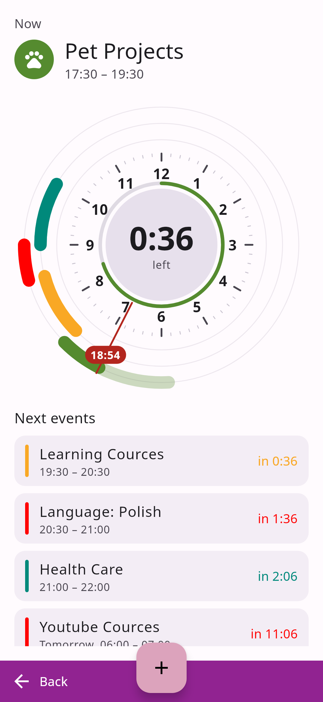

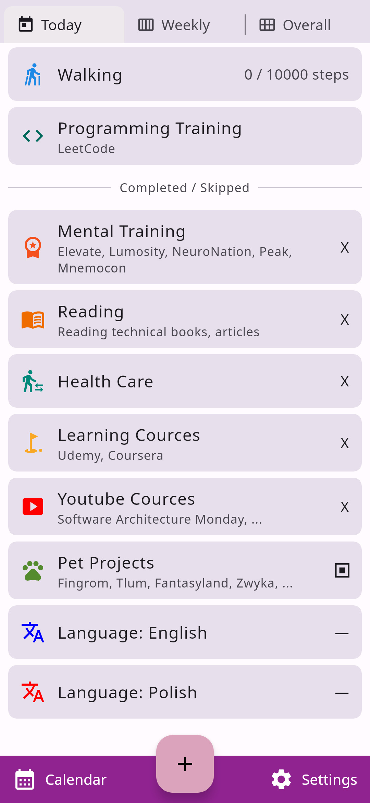 . 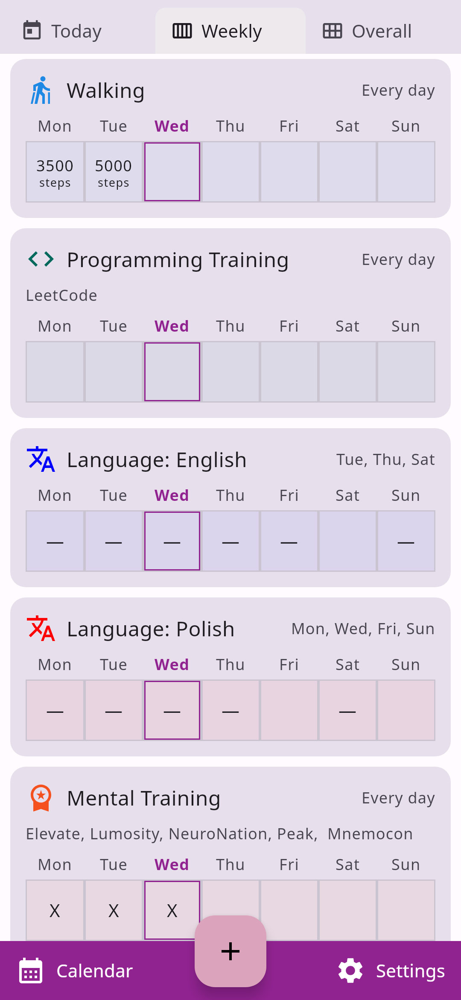 .

## Support (Sponsorship)

As an open-source project, subscribing will not unlock any additional features in the app. However, it would serve as
an investment in the continuous evolution and improvement of the application. So, if you'd like to contribute
financially towards the efforts, please consider these options:

* [Github Sponsorship](https://github.com/users/lyskouski/sponsorship)
* [Paypal](https://www.paypal.me/terCAD)
* [Patreon](https://www.patreon.com/terCAD)
* [Donorbox](https://donorbox.org/tercad)

Or, [buy a :coffee:](https://www.buymeacoffee.com/lyskouski).

## Contributions

Any made contribution **is greatly appreciated** (also, by mentioning in `Contributors` section, `Release` notes, and
in the app `About` - `Contributors` as a gratitude), check [Contribution Section](./CONTRIBUTING.md) for more details.

However, if it's been chosen a contribution (not just typo corrections) to this repo, you agree that you're giving
me a non-exclusive license to use that content, as I (and my possible team) deem appropriate. You probably guessed
that already, but I just wanted to be extra clear on that.

## License & Copyright

The content herein are all &copy; 2026 **terCAD** Team (Viachaslau Lyskouski).

 This work is licensed under a <a rel="license" href="http://creativecommons.org/licenses/by-nc-nd/4.0/">Creative Commons Attribution-NonCommercial-NoDerivs 4.0 Unported License</a>:
- **Attribution**: provide a link to the license, and indicate if changes were made
- **NonCommercial**: cannot be used as a part of a commercial solution
- **NoDerivatives**: any modification (remix, transform, or build upon the material) cannot be distributed by your own.
  Push it back to the main repository (https://github.com/lyskouski/app-tracker) to unblock the distribution for made
  changes.
