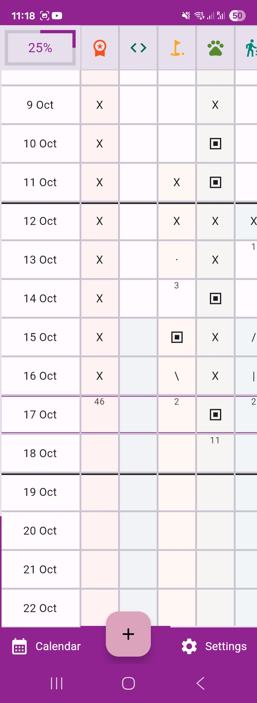
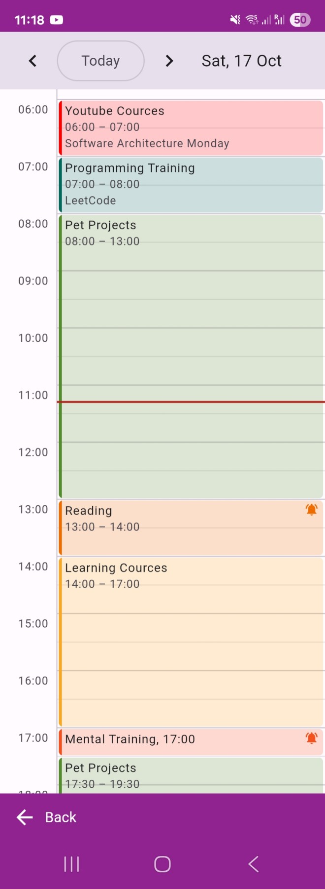
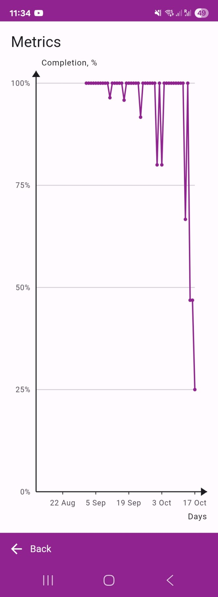

[اللغة العربية (AR)](./about_ar.md) |
[Azərbaycan dili (AZ)](./about_az.md) |
[Беларуская (BE)](./about_be.md) |
[Čeština (CS)](./about_cs.md) |
[Deutsch (DE)](./about_de.md) |
[English (EN-US)](./about_en.md) |
[Español (ES)](./about_es.md) |
[فارسی (FA)](./about_fa.md) |
[Français (FR)](./about_fr.md) |
[हिंदी (HI-IN)](./about_hi.md) |
[Bahasa Indonesia (ID)](./about_id.md) |
Italiano (IT) |
[日本語 (JA)](./about_ja.md) |
[ქართული (KA-GE)](./about_ka.md) |
[한국어 (KO)](./about_ko.md) |
[Nederlands (NL)](./about_nl.md) |
[Polski (PL)](./about_pl.md) |
[Português Brasileiro (PT-BR)](./about_pt.md) |
[Limba română (RO)](./about_ro.md) |
[Русский (RU)](./about_ru.md) |
[Türkçe (TR)](./about_tr.md) |
[Українська (UK-UA)](./about_uk.md) |
[Oʻzbekcha (UZ)](./about_uz.md) |
[简体中文 (ZH-CN)](./about_zh.md) |
[繁體中文 (ZH-TW)](./about_zh_TW.md) |

---

**Zwyka** -- applicazione open source e multipiattaforma per monitorare le abitudini, senza pubblicità né limitazioni.
L’obiettivo della soluzione è creare un’applicazione per il monitoraggio delle abitudini intuitiva, efficiente e inclusiva,
che consenta agli utenti di gestire le proprie abitudini senza sforzo, garantendo al contempo che nessuno venga lasciato
indietro.

  

### Funzionalità
- Abitudini
  - Titolo, note, icona (oltre 2.000 icone Material) e colore (palette o RGB / HEX personalizzato)
  - Giorni attivi della settimana; i giorni inattivi sono contrassegnati con "—"
  - Archiviare (disattivare) un’abitudine: viene mostrata in grigio, in fondo all’elenco e nascosta nella Pianificazione
- Calendario delle abitudini (pagina principale)
  - Abitudini (colonne) per giorni (righe): gli ultimi 66 giorni più i 5 successivi
  - Avanzamento giornaliero per abitudine: `·` iniziata, `\` 25%, `|` 50%, `/` 75%, `X` 100%, `▣` oltre il 100%
  - Avanzamento mostrato come simboli o come rettangoli colorati
  - Tocca una data per contrassegnare il giorno come saltato ("—") per tutte le abitudini non contrassegnate
  - Serie di giorni: il numero di giorni consecutivi contrassegnati (i giorni "—" non la interrompono)
  - Avanzamento di oggi: completamento complessivo delle abitudini di oggi
- Statistiche
  - Completamento giornaliero (%) negli ultimi 66 giorni
- Pianificazione (Calendario)
  - Vista giornaliera con le ore, come Google o Outlook Calendar
  - Pianifica un’abitudine per 30 minuti, 1 ora, 2 ore o un intervallo di tempo personalizzato, ripetuto nei giorni
    della settimana selezionati, con una nota facoltativa
  - Gli intervalli di tempo sovrapposti sono mostrati affiancati
  - Promemoria (notifiche)
  - Aggiunta a un calendario esterno (Apple, Google, Microsoft)
- Impostazioni
  - Localizzazione
  - Tema (di sistema, chiaro, scuro)
  - Inizio della settimana, formato delle date
  - Ordine delle abitudini (per data di creazione, ultimo aggiornamento o titolo; crescente o decrescente)
  - Importazione / Esportazione dei dati
- Esperienza utente
  - Design responsivo e adattivo
  - Scorrimento al tocco o con il mouse: `Scroll Wheel` per i giorni, `Shift` + `Scroll Wheel` per le abitudini
